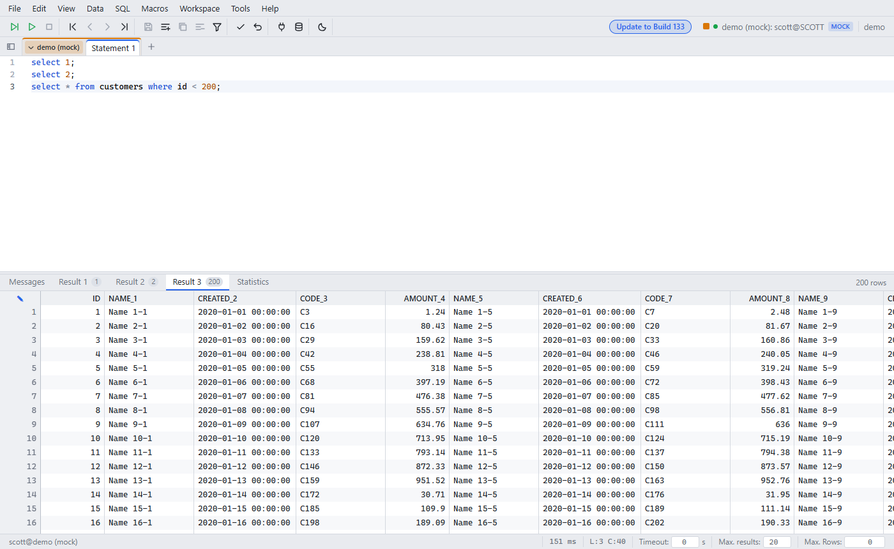
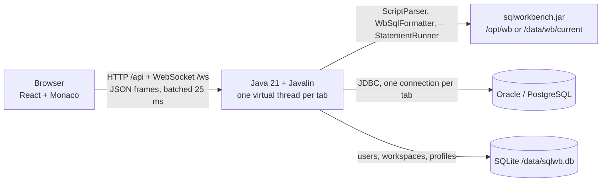

# sqlwb-web — SQL Workbench/J in the browser

A multi-user web version of [SQL Workbench/J](https://www.sql-workbench.eu/). It runs as one Docker container. The engine is the original `sqlworkbench.jar`, so statement split, formatting, variables and Wb commands behave like the desktop app.

Not affiliated with the SQL Workbench/J project.



Features with demo images: [docs/features/](docs/features/README.md). Changes per version: [CHANGELOG.md](CHANGELOG.md).

## Architecture



| Part | Choice | Why |
|---|---|---|
| Backend | Java 21, Javalin, virtual threads, ZGC | Uses the jar directly. Any JDBC driver. Short GC pauses |
| Frontend | React, Monaco, own virtual grid | Smooth with 100k rows |
| Result grid | Header click sorts the loaded rows (ascending, descending, off; NULL last). Double-click on a long value (JSON, XML, multi-line text) opens it formatted in an editor | Sort covers loaded rows only: use "Fetch all" or `ORDER BY` for the full result. CLOBs over 32,768 characters open read-only |
| Completion | Opens while typing, after `.`, and after `FROM `/`JOIN `/`WHERE ` etc.: tables and columns from the jar, keywords, functions, snippets. SQL → "Auto completion while typing" turns it off | Ctrl+Space always works |
| Transport | One WebSocket per browser tab, server sends JSON arrays every 25 ms | Thousands of statements do not flood the browser |
| Sessions | Cookie (30 days, renewed while used) + app login. Sessions are stored in SQLite (cookie hash, profile key encrypted with a key from the cookie value) | A browser restart or a deploy does not ask for the app login again |
| Saved work | `/api/workspace` in SQLite, per user, with a version (`X-Workspace-Version`, HTTP 409 on conflict) | Tabs, SQL, cursor, macros come back. Passwords are removed from the workspace |
| Connection profiles | Connection Manager (Alt+C): groups, filter, Test, import of desktop `WbProfiles.xml` / `.properties` | "Save password": AES-GCM with a key from the app password. Other passwords stay in browser memory |
| Drivers in the image | Oracle `ojdbc11`, PostgreSQL, H2 (H2 only for tests, see Security) | |
| Engine in the image | Built from source: codeberg.org/sql-workbench/workbench, tag `build${WB_BUILD}` | Same manifest and `ext/` jars as the official zip |
| Engine update | `/api/update` reads sql-workbench.eu, checks SHA-1, installs into `/data/wb/current`, restarts | Update button for admins |

## Quick start

```bash
docker run -d --name sqlwb-web -p 8484:8484 -v sqlwb-data:/data \
  -e DEFAULT_URL='jdbc:oracle:thin:@//db.example.com:1521/SERVICE' \
  -e ADMIN_USERS=alice \
  ghcr.io/lybaokhanh/sqlwb-web:latest
```

Open `http://localhost:8484`. Site config and deploy: [RUNBOOK.md](RUNBOOK.md).

## Settings (environment)

| Variable | Default | Meaning |
|---|---|---|
| `PORT` | `8484` | HTTP port in the container |
| `DEFAULT_NAME`, `DEFAULT_URL` | `local`, empty | Default connection of a new tab |
| `ADMIN_USERS` | empty = nobody | Comma list of app users who may install engine updates |
| `SIGNUP` | `true` | `true`: the first login with a new name creates the user. `false`: only existing users |
| `JDBC_URL_ALLOW` | `jdbc:(oracle\|postgresql):.*` | Regex of JDBC URLs users may open (also checked in Wb commands) |
| `WB_SITE` | `https://www.sql-workbench.eu/` | Update source |
| `JAVA_OPTS` | ZGC, heap 65% of the container limit, AppCDS | JVM settings |

Template for a site: [config.example/](config.example/).

## Security

| Topic | Note |
|---|---|
| Network | Plain HTTP. Run it in an internal network or behind a TLS proxy |
| Users | With `SIGNUP=true` everyone who reaches the port can create a user. Use `SIGNUP=false` after the first users exist |
| JDBC URLs | Embedded drivers (H2, Derby, HSQLDB) can run Java code in the container. Keep them out of `JDBC_URL_ALLOW` on a shared server |
| Wb commands | `WbSysExec`, `WbSysOpen`, `WbSetProp`, `WbConnect`, driver commands are blocked. File arguments must stay in the user file area |
| Login | 5 failed logins per name or IP lock the login for 1 minute |
| DB passwords | Never in the workspace. Saved only when "Save password" is on (encrypted, key derived from the app password) |

## Files

| Path | Content |
|---|---|
| `backend/src/main/java/local/sqlwb/` | `App` (HTTP), `Sessions`/`Session`/`Win` (login, WS, batching), `TabConn` (JDBC per tab), `SqlText` (parser/formatter), `Vars`, `Meta` (explorer, grid save), `WbBridge`, `UserFiles`, `LoadRun`, `Updater`, `Store`, `ProfileImport`, `Policy` |
| `frontend/` | React app ([frontend/README.md](frontend/README.md)) |
| `Dockerfile`, `docker/entrypoint.sh`, `docker-compose.yml` | Image and run config |
| `config.example/` | Site config template (env file, compose override) |
| `scripts/deploy.sh` | Deploy on a Docker host with health check and rollback |
| `scripts/smoke-ws.mjs`, `scripts/smoke-wb.mjs`, `scripts/smoke-vars.mjs` | Protocol smoke tests against H2 |
| `scripts/bench.mjs` | Benchmark against a real DB |
| `.github/workflows/docker.yml` | Image build; tag `v*` pushes to GHCR |
| [docs/benchmarks.md](docs/benchmarks.md) | Benchmark results |
| [docs/features/](docs/features/README.md), `docs/images/` | Feature docs and demo images ([CONTRIBUTING.md](CONTRIBUTING.md#feature-docs-and-releases)) |
| `CHANGELOG.md`, `.github/workflows/release.yml` | Release notes per version |
| `scripts/check-docs.mjs`, `.github/workflows/docs.yml` | Docs check: a `feat` needs doc, image and changelog entry |

## License

Apache-2.0 ([LICENSE](LICENSE)). SQL Workbench/J is Apache-2.0 too; the image builds it from source.
