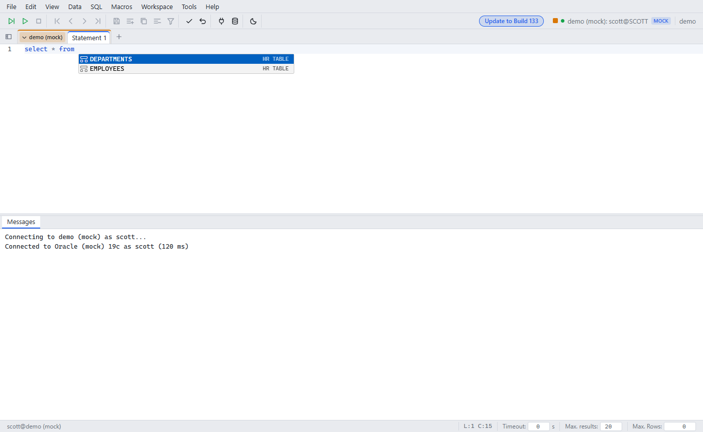

# Auto completion

Since: v0.1.1

| Item | Behavior |
|---|---|
| While typing | Keywords in the case you type, functions, snippets |
| After `.` | Columns of the table or alias |
| After `FROM` / `JOIN` / `WHERE` | Tables and columns from the engine |
| Off | SQL → Auto completion while typing |
| Manual | Ctrl+Space always works |
