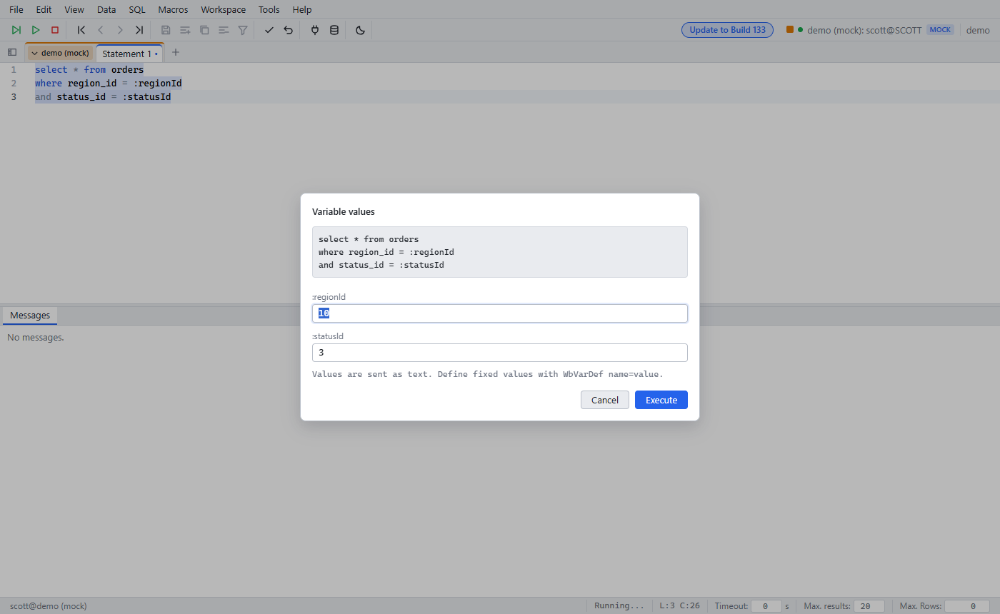

# Bind variables: ask for missing values

Since: Unreleased

A statement with `:name` variables runs as a prepared statement with binds. When a variable has no value, the run stops and asks for it.

| Item | Behavior |
|---|---|
| `:name` without a value | A dialog asks for the value before the statement runs |
| `$[&name]` without a value | Asks, the same as `:name` |
| `$[?name]` | Always asks, also when the variable has a value |
| `WbVarDef name=value` | Gives a fixed value. The run does not ask |
| Several variables | One dialog with all missing names of the statement |
| One run | Each name is asked once per run, also in **Execute All** with many statements |
| Next run | Asks again. The last values are filled in |
| Messages | The run logs the values: `Variables: regionId = '10', statusId = '3'` |
| Cancel / Escape | The run stops. The statement does not run |
| Not a variable | `:x` in a string (`'HH24:MI'`), a comment, `::` (PostgreSQL cast), and PL/SQL blocks (`:new`, `:old`) |

## Use

1. Write the SQL with `:name` variables, for example `where region_id = :regionId`.
2. Press Ctrl+Enter.
3. Type the values. Press Enter to run.

## Limits

| Limit | Note |
|---|---|
| Type | Values go to the database as text. Oracle converts them (`'10'` to a number) |
| Empty value | An empty string. Oracle reads it as NULL |
