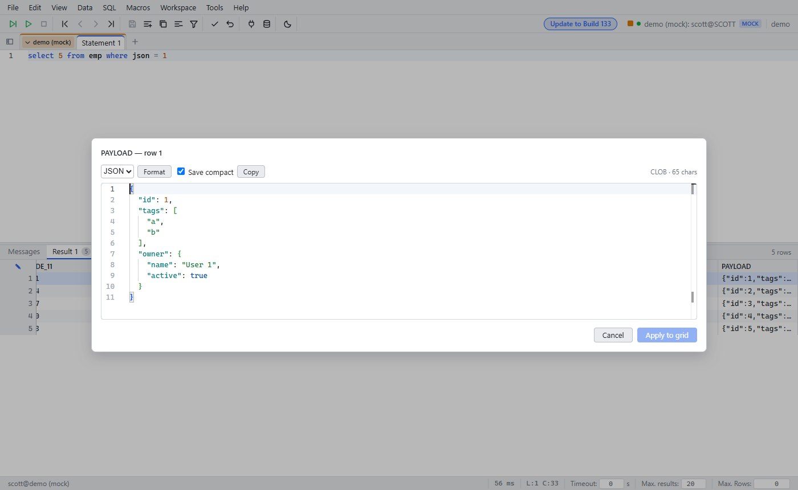

# Cell dialog for long values

Since: v0.1.1

| Item | Behavior |
|---|---|
| Open | Double-click a long value (JSON, XML, multi-line text). Short values edit inline |
| Format | JSON and XML are pretty-printed. Pick the language in the dialog |
| Apply to grid | Writes the value back. **Save compact** removes the formatting |
| Limit | CLOBs over 32,768 characters open read-only |
