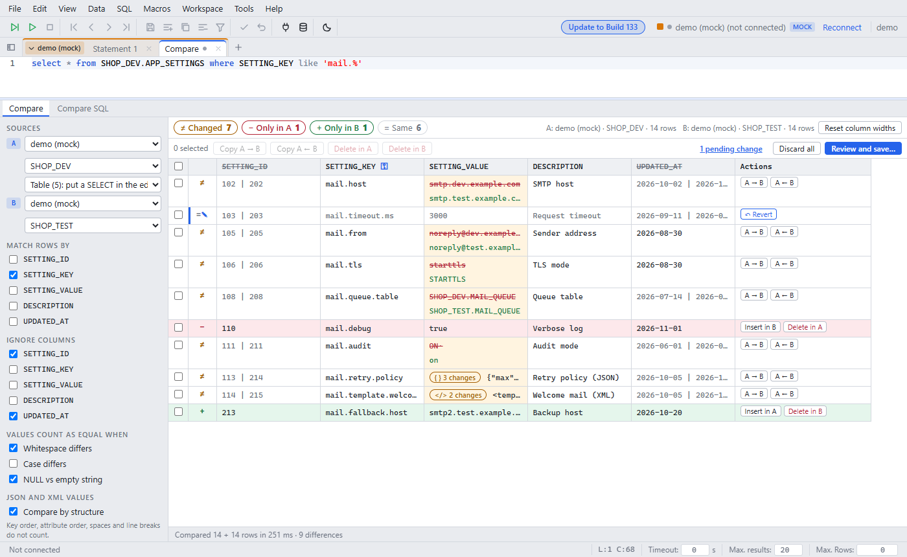

# Compare tab: compare and fix rows across schemas

Since: v0.4.0

Open **Tools > Compare data...**. A new Compare tab opens: the SQL editor on top, the compare below. Pick A and B, type a SELECT (or pick a table), then click **Compare** or press Ctrl+Enter. The app runs the query in A and in B and matches the rows by key.

| Item | Behavior |
|---|---|
| Sources | A and B: any connection profile and schema. A new Compare tab starts with the last A and B (kept in this browser). The first time, A is the connection and schema of the active tab. Schema and table lists load once per session and are shared by all Compare tabs. A profile with no password in memory shows a password box |
| SQL | The selection, else the statement at the cursor. SELECT only. **Table** lists the tables of A and puts `select * from <schema>.<table>` into the editor |
| Query in B | The table of a single-table SELECT gets the schema of B. Other queries run unchanged in B (compare only, no editing) |
| Connections | A and B run on their own server connections. Other tabs and their transactions stay as they are. Connect (switch all tabs) does not change a Compare tab |
| Match rows by | Key columns pair the rows of A and B. Default: the primary key. Duplicate keys pair up in order. The choice is kept per table in this browser |
| Ignore columns | These columns do not count for the status. The grid shows both values in grey. **Hide ignored columns in the grid** removes them from the grid (kept in this browser) |
| Equal when | Whitespace, case, NULL vs empty string. Plain decimals compare by value (1.50 = 1.5). The choices are kept in this browser |
| JSON and XML | Compared by path: key order, attribute order, spaces and line breaks do not count. Option: array order does not count. A JSON subtree on one side only, or an emptied array or object, is one row |
| Status chips | Changed, Only in A, Only in B, Same. Click a chip to show or hide its rows |
| Columns | Click a header to sort (A value, else B; the status column sorts by status). Click again: descending, then off. Drag a header border to resize. Double-click it to fit. Arrow keys: ±10 px. Widths are kept per table in this browser |
| Row actions | The Actions column stays on the right edge when the grid scrolls. A → B, A ← B (changed rows); Insert in A / B, Delete in A / B (rows on one side). Tick rows to do it in bulk |
| Edit dialog | Double-click a cell. A and B in text boxes with a line and word diff, line numbers, a live path table for JSON and XML, copy arrows, **↶ Revert cell**. Drag the bar between the path table and the text boxes. Lines that only moved get a dotted mark. Resize it, or maximize it (⤢ or double-click the title) |
| Pending changes | Changes stay pending until you save. A row with a pending change stays visible, also when its chip is off. **↶ Revert** undoes one row |
| Review and save | Lists the INSERT, UPDATE and DELETE statements per schema. Revert one statement to leave it out. Each schema runs in one transaction and commits. A failed statement rolls back that schema |
| Primary key | Statements find rows by the primary key. The key is read-only. A table without a primary key can be compared, not edited |
| Read-only profile | No actions on that side. Save does not write to it |
| Compare SQL | The same compare as one FULL OUTER JOIN statement (same connection). For two connections it shows both queries |
| Workspace | Compare tabs are not saved with the workspace |
| Limit | 50,000 rows per side. Bind variables are not asked: put the values into the SQL |
