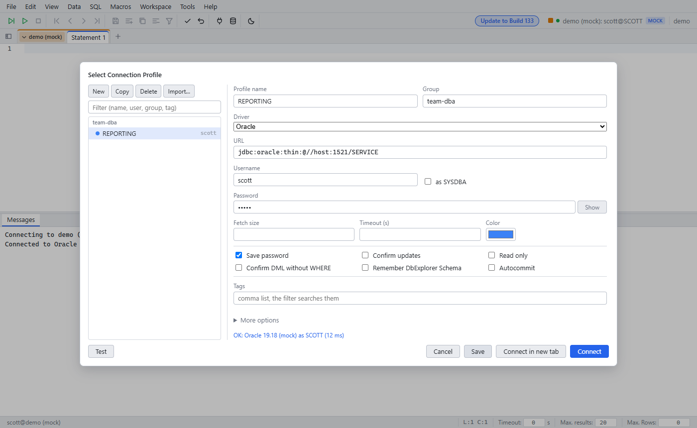

# Connection Manager

Since: v0.1.0

| Item | Behavior |
|---|---|
| Open | Alt+C |
| Profiles | Name, group, JDBC URL, user, options. A filter field finds profiles |
| Test | Opens a test connection and shows the result |
| Save password | Off: the password stays in browser memory. On: the server stores it encrypted (AES-GCM, key from the app password) |
| Import | `WbProfiles.xml` or `.properties` from the desktop app |
| Profile options | Read-only, confirm updates, confirm DML without WHERE. See [Safe execution](safe-execution.md) |
| Connect | Switches the tabs of the group to the profile. **Connect in new tab** opens a new group. See [Tab groups](tab-groups.md) |
