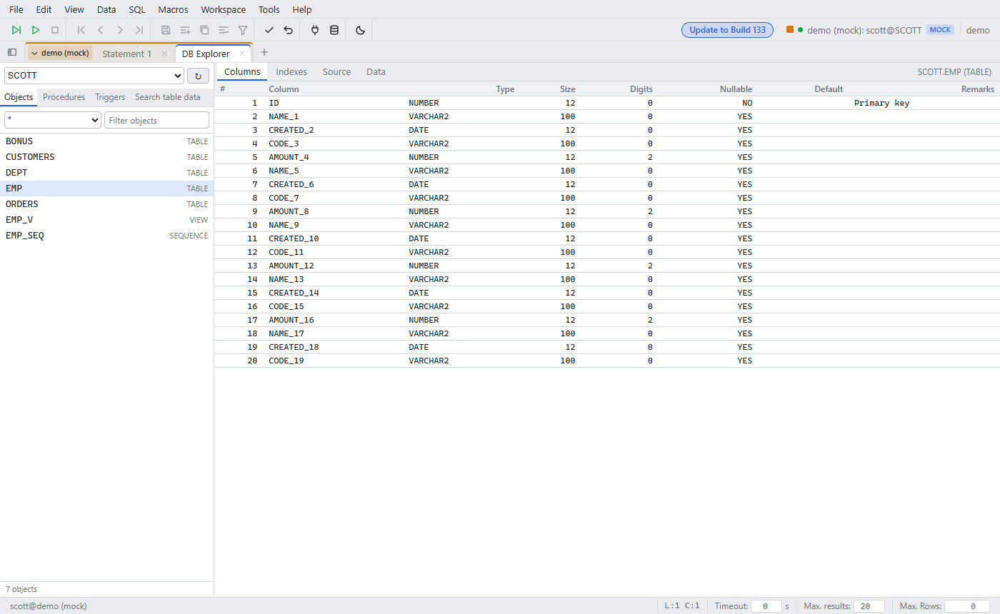

# DB Explorer

Since: v0.1.0

| Item | Behavior |
|---|---|
| Open | Ctrl+D. One explorer per schema |
| Objects | Tables, views, sequences. Filter by type |
| Details | Columns, indexes, source, data |
| Procedures | Source and parameters |
| Triggers | Table, timing and event |
| Search table data | Searches a value in the selected tables and shows the hits |
| Context menu | **Put SELECT in editor** writes a `SELECT` into the statement tab |
