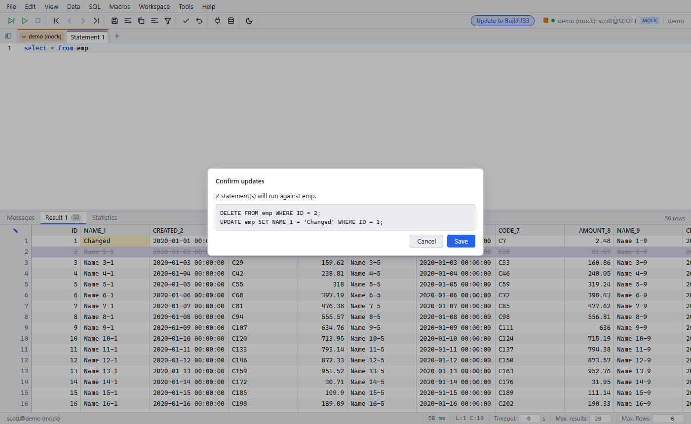

# Editable result grid

Since: v0.1.0

| Item | Behavior |
|---|---|
| Edit | Double-click a cell. Long values open in the [cell dialog](cell-dialog.md) |
| Insert / copy / delete row | Toolbar or Data menu |
| Save changes | Shows the `UPDATE`, `INSERT`, `DELETE` statements. Click **Save** to run them |
| No primary key | A dialog asks for the key columns |
