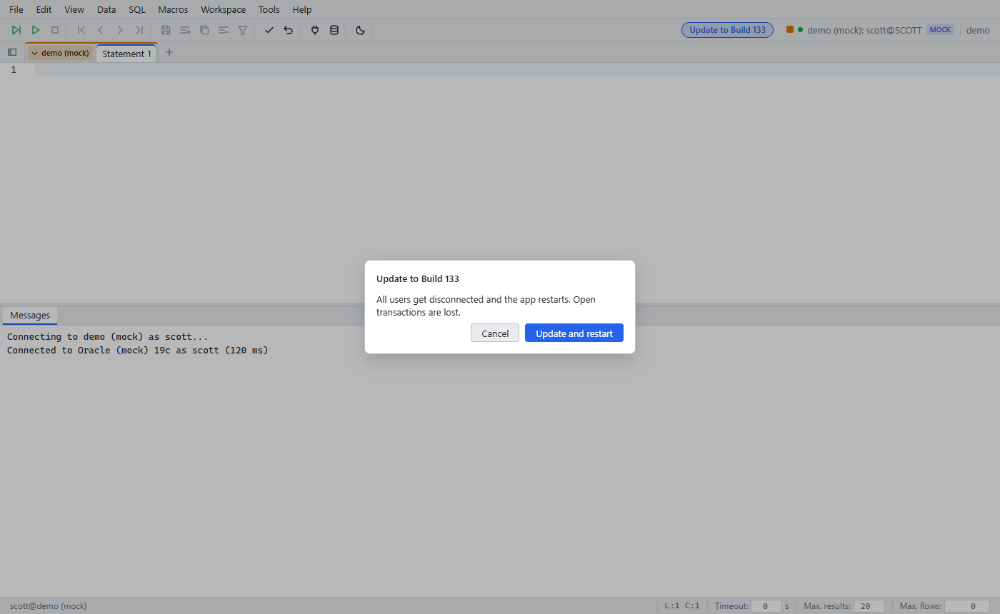

# Engine update

Since: v0.1.0

| Item | Behavior |
|---|---|
| Who | Users in `ADMIN_USERS` |
| Button | **Update to Build N** shows when sql-workbench.eu has a new build |
| Install | Download, SHA-1 check, install into `/data/wb/current`, restart |
| Effect | All users get disconnected. The workspace comes back after the restart |
