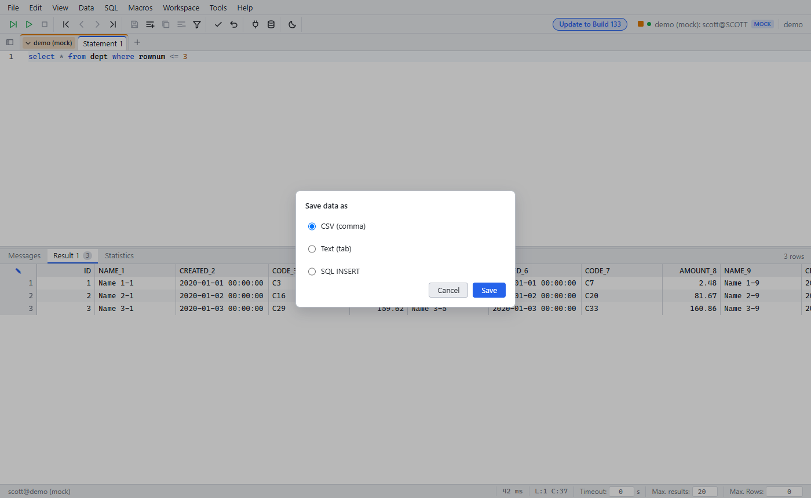

# Export

Since: v0.1.0

| Item | Behavior |
|---|---|
| Save data as | CSV, TSV, SQL INSERT. The browser downloads the file |
| Copy to clipboard | Ctrl+Y (tab separated) |
| Copy as SQL INSERT | Data menu |
| Wb commands | `WbExport` / `WbImport` write and read the user file area (Tools → Files) |
