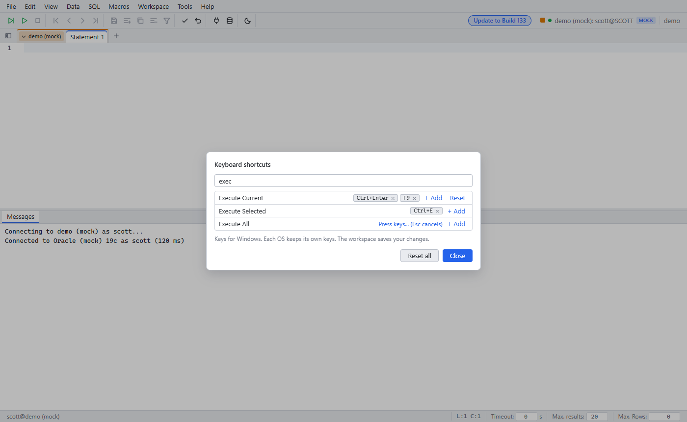

# Keyboard shortcuts per OS, change keys

Since: Unreleased

Hotkeys work in a normal browser tab. You do not need to install the app (PWA).
Each OS gets its own default keys. You can change all keys.

| Item | Behavior |
|---|---|
| OS | The app finds the OS of the browser: Windows, macOS or Linux |
| Windows / Linux | Keys use Ctrl. Menus show `Ctrl+Shift+E` |
| macOS | Keys use ⌘ (Cmd). Menus show symbols: `⇧⌘E`, `⌘↩` |
| Browser and OS keys | The browser or the OS keeps some keys (Ctrl+T, Ctrl+W, Ctrl+Tab, ⌘Q, ⌘M). Menus show only keys that work |
| Change keys | Help → Keyboard shortcuts |
| Saved | In the workspace on the server, per OS. A Mac and a Windows PC keep different keys |
| Load | The app reads saved keys without case: "ctrl+e" is Ctrl+E. It drops invalid and duplicate keys |

## Change keys

1. Open Help → Keyboard shortcuts.
2. Type in the filter box to find the action.
3. Click **+ Add**. Press the new key. Esc cancels.
4. Click × on a key to remove it. Built-in keys have no ×.
5. Click **Reset** to get the default keys back. **Reset all** resets all actions.

| Case | Result |
|---|---|
| The browser or the OS keeps the key | Error: "The browser or OS keeps this key". Press another key |
| A macro uses the key | Error with the macro name. Change the macro key in Macros → Manage macros |
| Another action uses the key | The key moves to this action. The row shows "Moved from <action>" |
| Key without Ctrl, Alt or ⌘ | Error. Plain keys are for typing. Function keys (F1 to F12) are allowed |
| Ctrl+C, Ctrl+V, Ctrl+X, Ctrl+A (⌘ on macOS) | Error: "Copy, paste, cut and select all need this key" |
| Windows / Linux: Ctrl+Alt+letter, digit or punctuation (also with Shift) | Error: "AltGr types characters with this key on many keyboards" |
| macOS: ⌥+letter, digit or punctuation (also with ⇧), without ⌘ or ⌃ | Error: "Option types characters with this key" |
| Ctrl+Alt / ⌥ with F1 to F12, arrows, Enter, PageUp, PageDown | Allowed |
| A built-in key of another action | Error: "The editor keeps this key for <action>". The key does not move |

## Built-in editor keys

| Item | Behavior |
|---|---|
| Actions | Undo, Redo, Find, Replace, Jump to line, Code completion |
| Built-in keys | The default keys of these actions on this OS. The editor keeps them |
| Key editor | Shows them as "built-in" chips without ×. Tooltip: "The editor keeps this key". Reset keeps them |
| In inputs | A built-in key stays with the input. Ctrl+Z in the grid filter undoes the typing in the filter |
| Added keys | A key that you add runs the action from the app, also when the focus is in an input |

## Default keys that differ on macOS

| Action | Windows / Linux | macOS |
|---|---|---|
| Replace | Ctrl+H | ⌥⌘F |
| Jump to line | Ctrl+G | ⌃G |
| Next / previous tab | Alt+PageDown / Alt+PageUp | ⌃⌥→ / ⌃⌥← |
| History back / next | Alt+Left / Alt+Right | ⌃⌥↑ / ⌃⌥↓ |
| Manage macros | Ctrl+M | ⇧⌘M |
| Code completion | Ctrl+Space | ⌃Space |

## Limits

| Limit | Note |
|---|---|
| Macro keys | Set in Macros → Manage macros. `Ctrl` in a macro key means ⌘ on macOS. Case does not matter: `ctrl+semicolon` works |
| Win / Super key | No default uses it. The OS keeps most of these keys |
