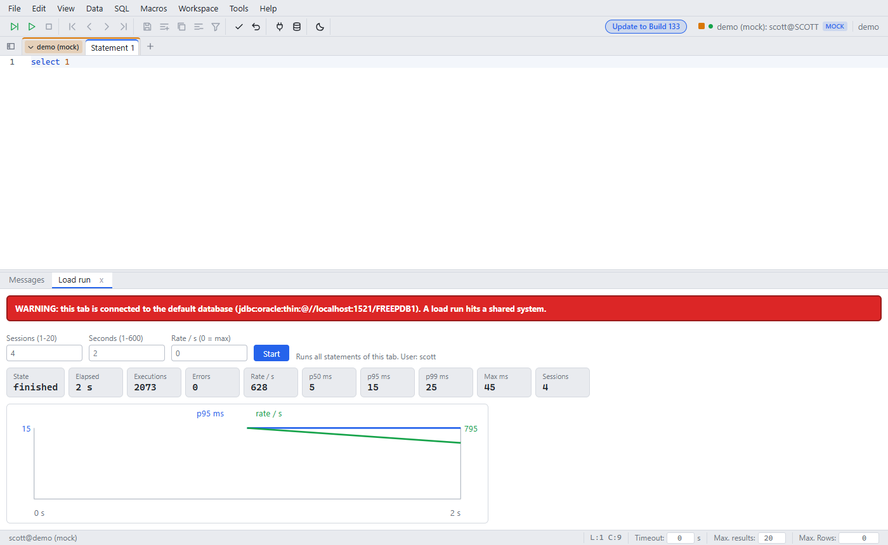

# Load run

Since: v0.1.0

| Item | Behavior |
|---|---|
| Open | Tools → Load run |
| Run | Runs the editor SQL again and again for the given seconds |
| Result | Statement count, timings and a chart |
| Warning | The default database shows a warning. You confirm before the start |
