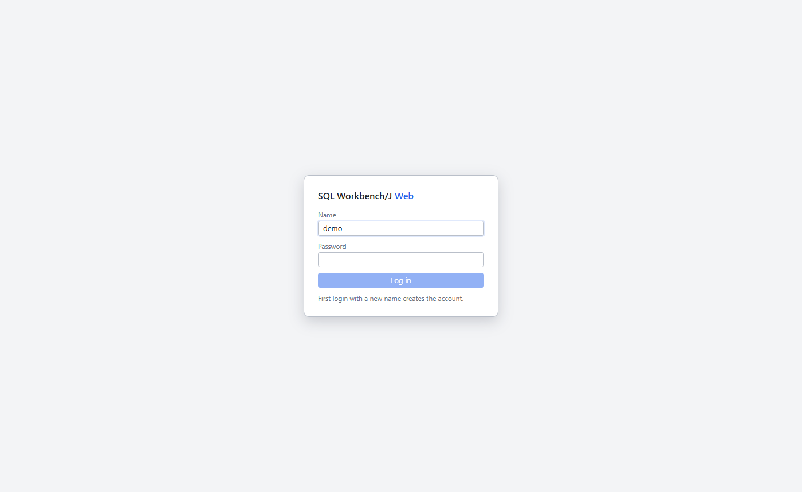

# Login and sessions

Since: v0.1.0

| Item | Behavior |
|---|---|
| App login | User name and password of sqlwb-web. Not the database login |
| New user | With `SIGNUP=true`, the first login with a new name creates the account |
| Session | Cookie, 30 days, renewed while used. A browser restart or a deploy keeps you logged in |
| Lockout | 5 failed logins per name or IP lock the login for 1 minute |

## Use

1. Open `http://<host>:8484`.
2. Type the app user and password.
3. Click **Log in**.
