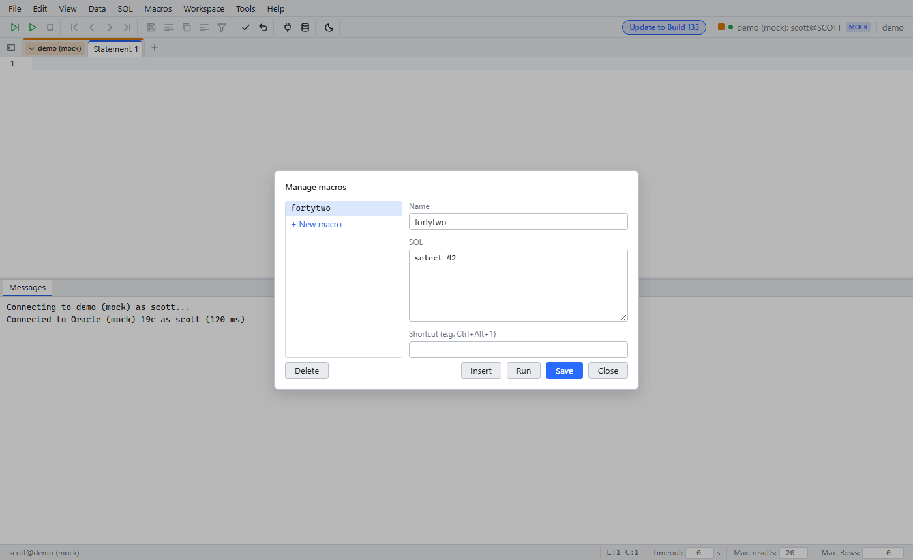

# Macros and bookmarks

Since: v0.1.0

| Item | Behavior |
|---|---|
| Macros | Ctrl+M opens **Manage macros**. Run a macro from the Macros menu |
| Bookmarks | A comment `-- @WbTag <name>` marks a line. Tools → Bookmarks lists them and jumps to the line |
| Saved | Macros are part of the workspace |
