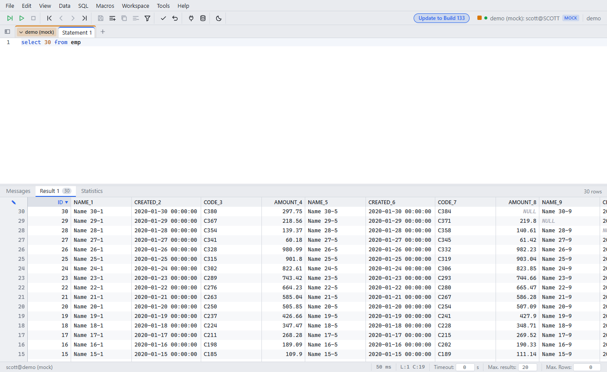

# Sort by column header

Since: v0.1.1

| Item | Behavior |
|---|---|
| Click header | Ascending → descending → off |
| Types | Numbers sort as numbers. NULL is always last |
| Row number | Shows the load order, so edits and deletes target the right row |
| Limit | Sorts the loaded rows only. Use **Fetch all** or `ORDER BY` for the full result |
