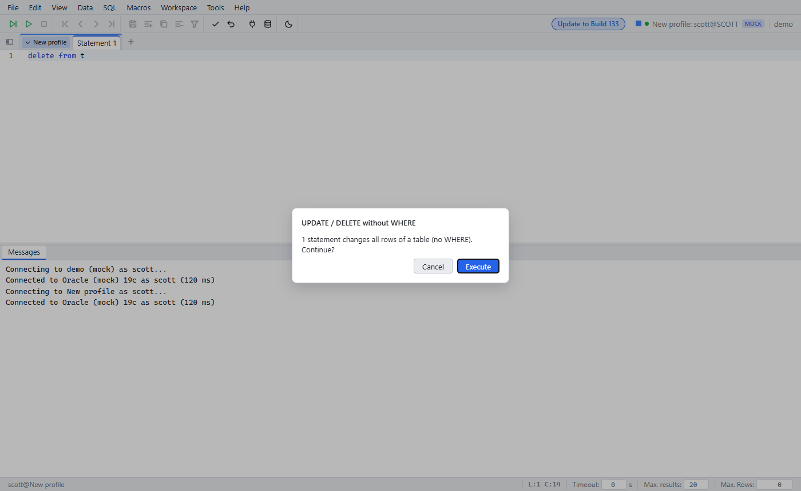

# Safe execution

Since: v0.1.0

Profile options in the [Connection Manager](connection-manager.md):

| Option | Behavior |
|---|---|
| Read-only | DML and DDL are blocked. `SELECT` runs |
| Confirm updates | Each run with DML asks first |
| Confirm DML without WHERE | `UPDATE` / `DELETE` without `WHERE` asks first. With `WHERE` it runs at once |
| Check uncommitted | Closing a tab with open DML asks first |
