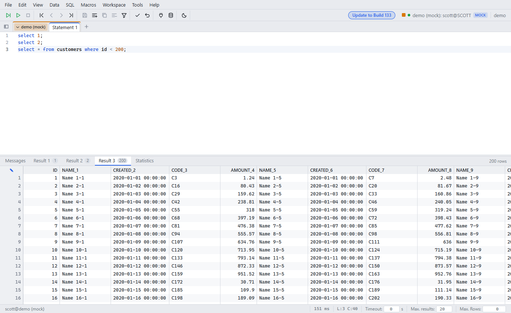

# SQL editor and execution

Since: v0.1.0

| Item | Behavior |
|---|---|
| Editor | Monaco with SQL syntax, find and replace, comment, case change |
| Statement split | Done by the `sqlworkbench.jar` engine, same as the desktop app |
| Results | One result tab per `SELECT`. **Max. results** caps the number of result tabs |
| Statistics | After **Execute All**: count, distinct statements, durations. Export as CSV |
| History | Previous and next statements per tab |

## Shortcuts

| Action | Keys |
|---|---|
| Execute Current | Ctrl+Enter |
| Execute Selected | Ctrl+E |
| Execute All | Ctrl+Shift+E |
| Reformat SQL | Ctrl+R |
| Commit / Rollback | Alt+M / Alt+R |
| History back / next | Alt+Left / Alt+Right |
| Jump to statement | Ctrl+J |
| All shortcuts | Help → Keyboard shortcuts |
