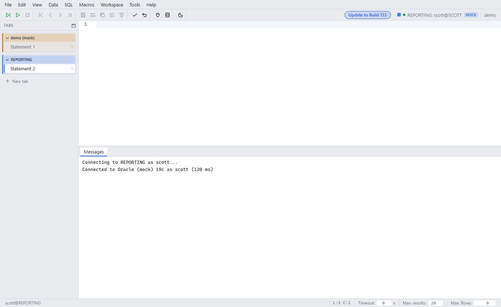

# Tab groups and vertical tabs

Since: v0.1.0

| Item | Behavior |
|---|---|
| Groups | Statement and DB Explorer tabs are grouped by connection profile. The header shows the name and color |
| Collapse | Click the group header. Only the active tab stays visible, with the tab count |
| Connect | Moves all tabs to the new schema. One DB Explorer stays |
| Connect in new tab | Opens a new group |
| Vertical tabs | Tabs move to a sidebar on the left. Drag the right edge to change the width |
| Saved | Layout and width stay after a reload (per browser) |

## Shortcuts

| Action | Windows / Linux | macOS |
|---|---|---|
| Vertical tabs on / off | Ctrl+Shift+, or Alt+Shift+T | ⇧⌘, or ⌥⇧T |
| Add tab | Alt+T | ⌥T |
| Close tab | Ctrl+K | ⌘K |
| Next / previous tab | Alt+PageDown / Alt+PageUp | ⌃⌥→ / ⌃⌥← |

The browser keeps Ctrl+T, Ctrl+W and Ctrl+Tab (⌘T, ⌘W, ⌃Tab on macOS). The app uses the Alt keys.

## Change keys

Open Help → Keyboard shortcuts. Click **+ Add** in the row of the action and press the new key.
The workspace saves the keys, per OS. Details: [Keyboard shortcuts](keyboard-shortcuts.md).
