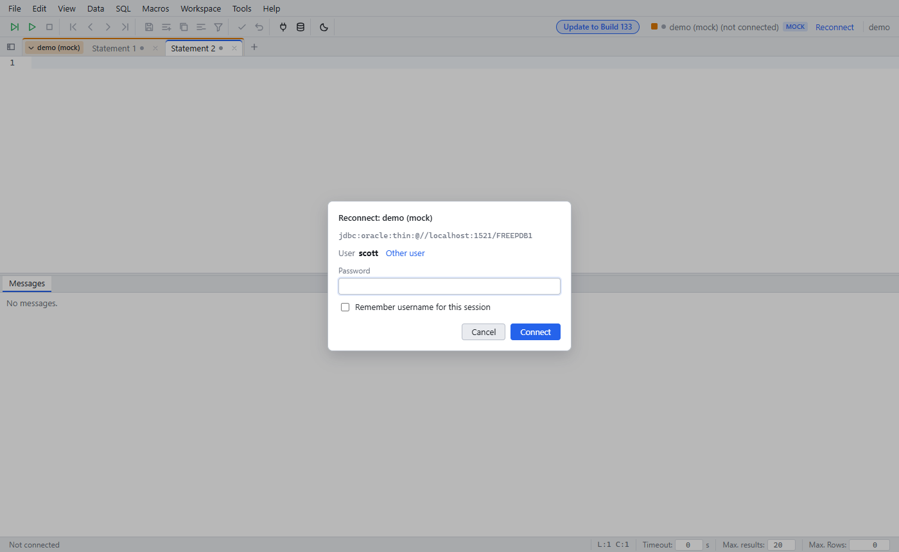

# Saved workspace

Since: v0.1.0

| Item | Behavior |
|---|---|
| Saved | Tabs, SQL, cursor, macros. Stored on the server per user, 1 s after a change |
| Reload | The workspace comes back. Only the database password is asked (unless saved) |
| Passwords | Never in the workspace |
| Save fails | A browser copy restores the work after a reload |
| Two browser tabs | The older tab gets a conflict dialog. No silent overwrite |
